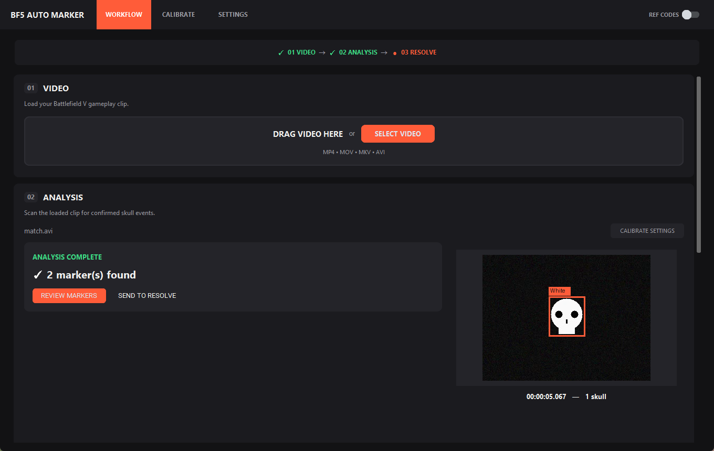
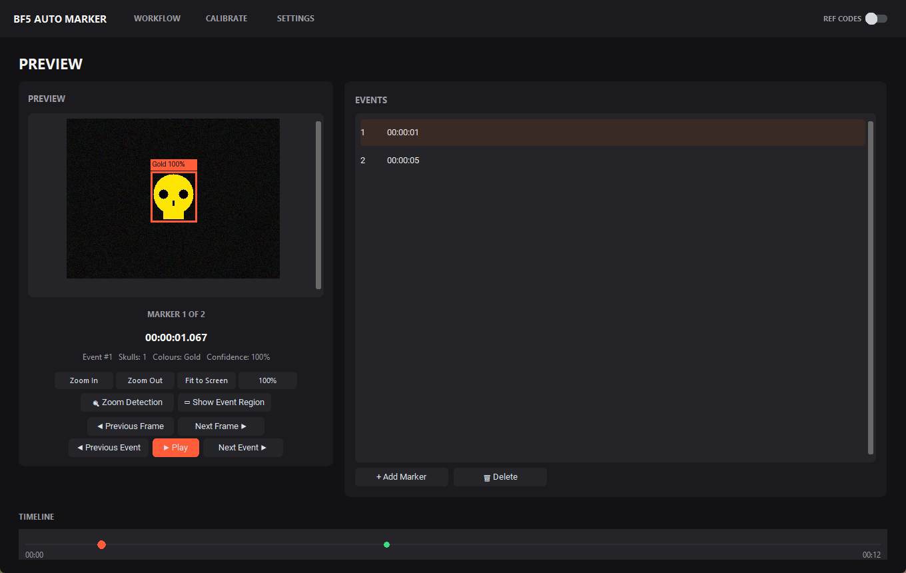

# BF5 Auto Marker


A dark-mode Windows desktop app that automates the "find the kill, mark the kill" part of a
Battlefield V edit. It scans a gameplay recording for the kill-confirmed skull in the kill feed
(white **and** gold skulls), groups each appearance into one event, and creates a marker for each
one on your DaVinci Resolve timeline. Everything runs locally -- no cloud, no internet needed after
installing the dependencies.

**Highlights**

- **Computer vision pipeline** (OpenCV + NumPy): multi-template shape matching plus colour-aware
  matching, neighbour-frame validation to reject one-frame flashes, and an event state machine that
  turns detections into one bookmark per kill.
- **Video editor automation**: sends the markers straight to the open DaVinci Resolve timeline through
  Resolve's scripting API, and writes CSV/TXT/JSON result files.
- **Desktop UI** in CustomTkinter with drag-and-drop, a live detection preview, a marker review page
  and one-time calibration that is reused for every video.
- **Robust by design**: atomic saves, tolerance of damaged settings files and full disks, and a
  197-test `unittest` suite that drives the real window against a fake Resolve timeline.

| Analysis finished | Reviewing the markers |
|---|---|
|  |  |

*Screenshots use the synthetic test clip from the test suite (a drawn skull on noise), not real footage.*

## Download and run (Windows)

1. Install [Python 3](https://www.python.org/downloads/) (the app is developed on 3.13).
2. Download **Source code (zip)** from the [latest release](https://github.com/REralph/bf5-auto-marker/releases/latest)
   and unzip it.
3. Double-click **`setup.bat`** once (it creates a private `.venv` and installs the libraries), then
   **`run.bat`** to start the app.

Finding the kills and writing the result files works on its own. Sending markers to a timeline needs
**DaVinci Resolve Studio** with external scripting switched on (see [Sending to Resolve](docs/USER_GUIDE.md#sending-to-resolve) in the user guide).

## How it works

One pass over the video. For each *sampled* frame (every Nth, see SETTINGS):

```
crop to the calibrated region
  → grayscale multi-template matching against every reference        (shape; the original detector)
  → colour-aware matching for coloured references such as gold       (structure + colour + edge + luminance,
                                                                       size, aspect, position)
  → merge candidates, name each skull from its own colour evidence
  → require the neighbouring frames to hold up too                   (rejects single-frame flashes)
  → event state machine: an event starts when the skull is confirmed, ends once it has been gone for a
    short grace period
```

Each event keeps four distinct moments -- never confuse them:

* **start** -- when the skull first appeared. **This is the bookmark** sent to Resolve.
* **end** -- the last frame it was still seen.
* **confirmation** -- when enough evidence existed to confirm (always after the end).
* **best frame** -- the clearest frame, used only for preview thumbnails.

Colour is a supporting signal for coloured skulls, never an exact-RGB test, and the global confidence
threshold is never lowered to make something "work".

## Tests

A 197-test standard-library `unittest` suite covers settings and persistence (including full-disk and
damaged-file cases), calibration storage, the detectors, the whole scan loop on generated clips, and the real
window end to end against a fake DaVinci Resolve timeline:

```bash
.venv\Scripts\python.exe -m unittest discover -s tests -t .
```

## More

- **[User guide](docs/USER_GUIDE.md)**: calibration, settings, sending to Resolve, troubleshooting,
  project structure, known limits and maintenance notes.
- **[Signal Chain](https://claude.ai/artifact/5yCEJiPrsehRWmbHv18zT7)**: a visual map of how a clip moves through the app's pages.

## Licence

[MIT](LICENSE) © 2026 Ralph Estrocio. Battlefield V and DaVinci Resolve are trademarks of their respective owners; this is an independent fan-made tool.
